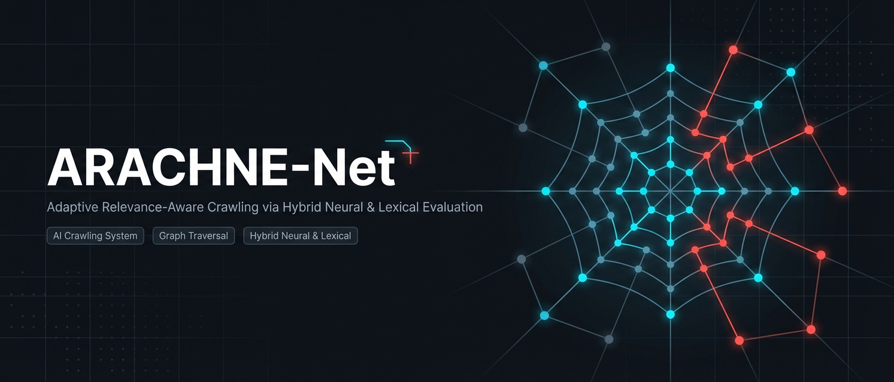

<div align="center">



# ARACHNE-Net

### Adaptive Relevance-Aware Crawling via Hybrid Neural and Lexical Evaluation

*A real-time focused web crawler that stops topic drift using depth-bounded asynchronous BFS and a three-signal hybrid relevance engine.*

[Architecture](#architecture) • [Scoring Engine](#hybrid-scoring-engine) • [Benchmarks](#benchmarks) • [Quick Start](#quick-start)

</div>

## Why ARACHNE-Net?

Standard Breadth-First Search (BFS) crawlers follow every hyperlink blindly and drift off-topic within 2–3 hops on densely linked sites like Wikipedia. Pure embedding-based crawlers suffer from **embedding score compression** (yielding only `r = 0.380` correlation with human judgment), while pure keyword filters miss semantically related pages.

**ARACHNE-Net** solves both problems by combining **dense neural semantics**, **sparse BM25 lexical matching**, and **structural positional cues**, refined with sigmoid contrast stretching and optional **Cross-Encoder reranking** — all streamed live over WebSockets with real-time threshold control.

## Architecture

```
flowchart LR
    UI["Web UI (index.html)<br/>Seed URL · Keywords · τ · Mode"] -- WebSocket /ws --> API["FastAPI + Uvicorn<br/>Async Orchestrator"]
    API --> BFS["Depth-Bounded BFS<br/>deque · visited set<br/>depth ≤ 3 · links ≤ 20"]
    BFS --> FETCH["Async Fetch & Parse<br/>requests (to_thread)<br/>BeautifulSoup4"]
    FETCH --> SCORE["3-Signal Hybrid Engine<br/>0.60 Semantic (MiniLM)<br/>0.25 Lexical (BM25Okapi)<br/>0.15 Positional Cue"]
    SCORE --> CE{"Mode == best?"}
    CE -- Yes --> RERANK["Cross-Encoder Rerank<br/>ms-marco-MiniLM-L-6-v2<br/>0.70·Base + 0.30·CE"]
    CE -- No --> SIG["Sigmoid Stretching<br/>1 / (1 + exp(-k·(S - 0.5)))"]
    RERANK --> SIG
    SIG --> GATE{"Score ≥ τ ?"}
    GATE -- "SAVE" --> DISK["Async Save (aiofiles)<br/>./results/{title}.txt<br/>+ Enqueue Links"]
    GATE -- "PRUNE" --> DROP["Discard Page<br/>Stop Branch Expansion"]
    DISK -. Live Event .-> UI
    DROP -. Live Event .-> UI

```

## Hybrid Scoring Engine

Each candidate page is evaluated against the user's target keywords using a weighted multi-signal fusion:

$$
S_{\text{base}} = 0.60 \cdot S_{\text{semantic}} + 0.25 \cdot S_{\text{BM25}} + 0.15 \cdot S_{\text{positional}}
$$

* **Semantic Signal (`60%`):** Cosine similarity via [`all-MiniLM-L6-v2`](https://huggingface.co/sentence-transformers/all-MiniLM-L6-v2) (384-dim sentence embeddings) captures conceptual meaning beyond exact words.

* **Lexical Signal (`25%`):** Sentence-level `BM25Okapi` normalized via $1 - e^{-0.1 \cdot \text{raw}}$ enforces exact term precision without keyword-stuffing bias.

* **Positional Cue (`15%`):** Scores `1.0` for title matches or $1 - \frac{\text{first\_idx}}{n}$ for early body occurrences.

* **Cross-Encoder Reranking (`best` mode):** Re-scores the top 8 sentences with [`cross-encoder/ms-marco-MiniLM-L-6-v2`](https://huggingface.co/cross-encoder/ms-marco-MiniLM-L-6-v2) and blends $0.70 \cdot S_{\text{base}} + 0.30 \cdot S_{\text{CE}}$.

* **Sigmoid Sharpening:** Applies $\sigma(S) = \frac{1}{1 + e^{-k(S - 0.5)}}$ to separate relevant and off-topic scores cleanly.

### Analysis Modes

| Mode | Cross-Encoder | Sigmoid Steepness ($k$) | Best Use Case | 
| ----- | ----- | ----- | ----- | 
| **`fast`** | Off | `5.0` | Rapid exploratory crawls | 
| **`balanced`** *(default)* | Off | `7.0` | General-purpose focused extraction | 
| **`best`** | On (Top 8 sentences) | `9.0` | High-precision corpus curation | 

## Benchmarks

Evaluated across a curated 20-topic Wikipedia benchmark (including adversarial mismatched-seed tests) and a 40-case relevance dataset included in this repository.

### 1. Hybrid Fusion vs. Single-Signal Baselines

| Scoring Method | Pearson Correlation ($r$) | 
| ----- | ----- | 
| **ARACHNE-Net (Hybrid Final)** | **0.959** | 
| Positional Cue Only | 0.910 | 
| BERT Only | 0.850 | 
| BM25 Only | 0.760 | 
| TF–IDF Only | 0.720 | 
| Dense Embedding Only | 0.380 | 

### 2. Threshold Sensitivity ($\tau$)

| Threshold ($\tau$) | Accuracy | SAVE Precision | PRUNE Recall | 
| ----- | ----- | ----- | ----- | 
| `0.20` | 80% | 100% | 20% | 
| `0.30` | 85% | 100% | 50% | 
| **`0.40` *(Optimal)*** | **90%** | **93%** | **83%** | 
| `0.50` | 85% | 79% | 100% | 

## Quick Start

### 1. Clone & Install Dependencies

```
git clone https://github.com/swayamsaini/ARACHNE-Net-Adaptive-Relevance-Aware-Crawling-via-Hybrid-Neural-and-Lexical-Evaluation.git
cd ARACHNE-Net-Adaptive-Relevance-Aware-Crawling-via-Hybrid-Neural-and-Lexical-Evaluation
pip install fastapi uvicorn requests beautifulsoup4 aiofiles sentence-transformers rank-bm25 numpy

```

### 2. Run the Server

```
python main.py

```

Open **`http://127.0.0.1:8000`** in your browser, enter a seed Wikipedia URL and target keywords, set the threshold (recommended: `0.35–0.40`), and watch live `Saved` / `Pruned` decisions stream in real time. Saved articles are written to `./results/`.

## Repository Structure

```
.
├── main.py                                    # FastAPI server, async BFS core & hybrid scoring engine
├── index.html                                 # Real-time WebSocket dashboard UI
├── wikipedia_crawler_test_dataset.csv         # 40-case multi-category evaluation dataset
├── wikipedia_crawler_test_dataset - Copy.csv  # 20-topic benchmark evaluation subset
└── assets/
    └── banner.jpg                             # Repository hero banner

```

## Author

**Swayam Saini** — [@swayamsaini](https://www.google.com/search?q=https://github.com/swayamsaini)